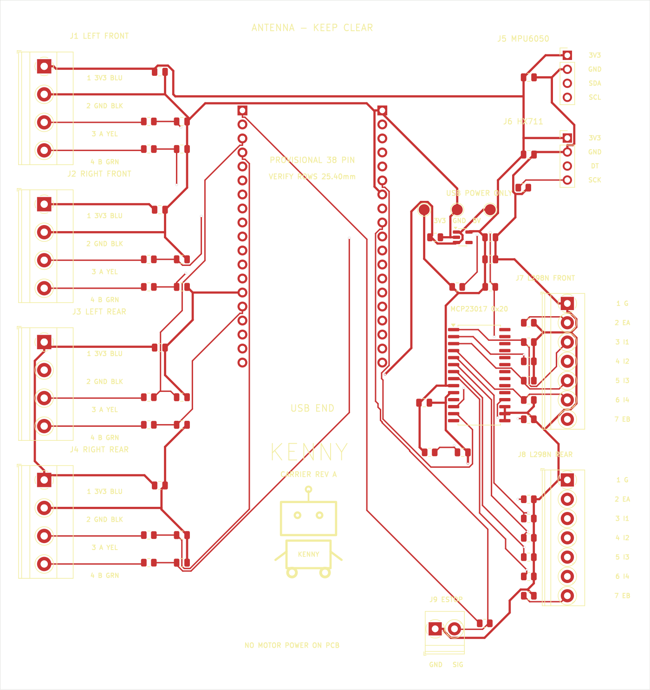

# KENNY ESP32 carrier PCB — provisional Rev A

**Editable, routed two-layer prototype design. Not yet fabrication-approved.**
The owner selected a provisional footprint because the actual 38-pin ESP32
module dimensions and model/pin ordering are not available. Print/check the
socket pattern and verify the actual modules before ordering boards.



## What is on the board

- **118 × 125 mm**, 2 copper layers, nominal 1.6 mm FR-4 / 1 oz copper.
- Two 19-position female sockets for a **classic ESP32-WROOM DevKit**.
  Assumed 2.54 mm pin pitch and **25.40 mm row-center spacing**.
- Four **4-position, 5.08 mm pitch screw terminals**, one per motor encoder.
- 2.54 mm Dupont headers for an external **MPU6050 module** and **HX711 module**.
- Separate front/rear L298N **7-position screw terminals**; independent control of
  each of the four motors. Driver boards and motor-power wiring are external.
- MCP23017 GPIO expander for eight direction signals; direct ESP32 PWM and
  encoder capture, with ESP32 pins available for the two additional sensors.
- AP2112K-3.3 peripheral regulator powered from the DevKit's USB-derived 5 V.
- Decoupling capacitors, encoder input RC filters, direction/PWM pull-downs,
  I²C pull-ups, reset RC and HX711 clock pull-down.
- A **2-position screw terminal** for the normally-closed E-stop signal.
- Four M3 clearance holes, a copper-free antenna region, **KENNY** text and a
  simplified monochrome robot logo based on the image supplied by the owner.
  The logo is real front silkscreen geometry, not just a preview overlay.

## Open the design

Open `kenny_carrier_revA.kicad_pro` in **KiCad 7 or later**.

| File | Purpose |
| --- | --- |
| `kenny_carrier_revA.kicad_sch` | Editable circuit schematic |
| `kenny_carrier_revA.kicad_pcb` | Routed PCB and bottom ground plane |
| `kenny_carrier_revA.kicad_pro` | Project and design rules |
| `schematic.pdf` | Readable vector schematic |
| `board-top.svg` / `.png` | Top copper and silkscreen preview |
| `board-preview.svg` / `.png` | Green-background layout preview |
| `assembly.svg` | Component references and fabrication outlines |
| `BOM.csv` | Values, footprints and component notes |
| `circuit.json` | Machine-readable pin/net/placement specification |
| `Kenny.pretty/` | Local provisional 38-pin footprint |
| `DRC.txt`, `validation.json` | Actual check results and limitations |
| `review_gerbers/` | Provisional Gerber/drill exports; NOT approved to manufacture |

Standard footprints require the KiCad footprint libraries. The included
`fp-lib-table` uses `KICAD7_FOOTPRINT_DIR`; on another version, point that variable
at the installed footprint directory in Preferences → Configure Paths.
All footprint geometry is also embedded in the PCB file.

## Motor encoder terminals

The user confirmed **4-pin encoder terminals**, so the red/white motor winding
wires do **not** pass through this carrier. They go directly to the L298N output
terminals as described below.

| Terminal | Motor |
| --- | --- |
| **J1** | Left-front encoder |
| **J2** | Right-front encoder |
| **J3** | Left-rear encoder |
| **J4** | Right-rear encoder |

Every encoder terminal uses this order, top-to-bottom in the top-view preview:

| Position | Signal | Supplier wire color |
| --- | --- | --- |
| **1** | **+3.3 V** encoder power | Blue |
| **2** | **GND** | Black |
| **3** | **A** | Yellow |
| **4** | **B** | Green |

The selected footprint is **Phoenix MKDS 1,5/4-5.08**, horizontal wire entry
toward the board's left edge, drill 1.3 mm. Match the purchased terminal's
mechanical drawing to this footprint; generic 5.0 mm and 5.08 mm blocks are
not automatically interchangeable.

Encoder A/B each pass through a **1 kΩ series resistor** into the ESP32 input,
with **1 nF C0G to GND** on the ESP32 side: nominal 1 µs RC. This is noise
filtering, **not 5 V level conversion or ESD certification**. The identified
supplier's encoders support a 3.3 V supply and include output pull-up circuitry.
If a different encoder is fitted, verify its output type/voltage first.

## Sensor Dupont headers

The square pad is pin 1. Wire **by signal**, not by blindly matching the physical
order of another module's connector. Headers are unkeyed; check polarity.

| Header | Pin 1 | Pin 2 | Pin 3 | Pin 4 |
| --- | --- | --- | --- | --- |
| **J5 MPU6050** | 3V3 | GND | SDA | SCL |
| **J6 HX711** | 3V3 | GND | DOUT / DT | SCK |

- MPU6050 I²C defaults to **0x68** when AD0 is low (0x69 if high). Tie AD0 on
  the module according to its documentation; this four-wire header does not
  carry AD0 or INT. Polling is supported. Use a module that operates correctly
  from the provided 3.3 V input; some boards expose a regulator VIN with dropout.
- MCP23017 address pins are grounded for **0x20**, so it does not conflict with MPU6050.
- HX711 is an **external amplifier board**, not the bare four-wire load cell.
  The load cell connects to that module's E+/E− and A+/A− inputs according to
  the load-cell datasheet. HX711 is not I²C. Use 3.3 V-compatible module power,
  excitation and DOUT logic; calibrate tare and scale in software.
- R21/R22 are **4.7 kΩ SDA/SCL pull-ups** to peripheral 3.3 V. If the MPU module
  has its own pull-ups, check the combined resistance and leave R21/R22 unpopulated
  if needed. Keep sensor cables short, start I²C at 100 kHz, and route them away
  from motor-power wires.

## L298N terminal blocks and motor connections

| Terminal block | External board | OUT1 / OUT2 | OUT3 / OUT4 |
| --- | --- | --- | --- |
| **J7 FRONT** | L298N #1 | Left-front red / white | Right-front red / white |
| **J8 REAR** | L298N #2 | Left-rear red / white | Right-rear red / white |

J7/J8 are **Phoenix PT 1,5/7-3.5-H**, 7 positions, **3.50 mm pitch**,
1.2 mm drill, with wire entry toward the right board edge. Match the purchased
part to the footprint; this is not a 5.08 mm or 2.54 mm terminal footprint.
For both J7/J8, **top-to-bottom** in the top-view preview:

| Pin | Silkscreen | Connect to L298N |
| --- | --- | --- |
| 1 | G | GND |
| 2 | EA | ENA |
| 3 | I1 | IN1 |
| 4 | I2 | IN2 |
| 5 | I3 | IN3 |
| 6 | I4 | IN4 |
| 7 | EB | ENB |

**Remove ENA/ENB jumpers on both L298N boards.** Four 10 kΩ enable pull-downs
are on the carrier; eight direction pull-downs hold the inputs low while the
MCP23017 is reset/high-impedance. There are **no shared direction signals**
between motor channels. Add pull-downs at the external driver ends too if the
driver must remain disabled when the control cable itself is disconnected.

Motor battery wiring, fused power distribution, appropriate motor-driver cooling
and physical power-cut E-stop are external. No 12 V or motor current belongs on
J1–J9. Add motor-noise suppression close to the motors as appropriate (typically
100 nF ceramic across each motor's winding terminals, rated at least 50 V) and
bulk decoupling at each external driver per its power design. These off-board
parts are not included in the carrier placement/BOM.

The supplied 333 RPM NFP-JGB37-520-EN motor is **12 V, 30:1, 2.4 A stall per motor**.
That exceeds the common L298N continuous-channel rating. This PCB is only a logic
interface and does not resolve that motor/driver sizing issue. Review or replace
the external drivers before loaded robot operation.

## Power and passive components

USB → ESP32 DevKit **5 V header pin** → AP2112K-3.3 → **+3V3 peripherals**.
The ESP32's own 3.3 V rail is separate and is used only for the E-stop pull-up.
There is no external power input or USB/external-supply selector on this carrier.

**Confirm the chosen DevKit exposes USB-derived 5 V at the assumed pin**. A pin
labeled VIN on an unknown clone is not proof that this source is available.
Use only one verified USB supply, and never bring L298N motor/5 V power back
through a logic header. There is no onboard fuse or surge/5 V encoder protection.

| References | Value/function |
| --- | --- |
| R1–R8 / C1–C8 | 1 kΩ / 1 nF encoder input filters |
| C9–C12 | 100 nF encoder connector decoupling |
| R9–R16 | 10 kΩ MCP direction pull-downs |
| R17–R20 | 10 kΩ motor-enable pull-downs |
| R21–R22 | 4.7 kΩ I²C pull-ups |
| R23 / C19 | 10 kΩ / 100 nF MCP reset RC |
| R24 | 10 kΩ ESP32 E-stop input pull-up |
| R25 | 10 kΩ HX711 SCK pull-down |
| C13 / C14 | 1 µF regulator input / 10 µF output |
| C15 | 100 nF at MCP23017 |
| C16 / C17 | 100 nF at MPU6050 / HX711 headers |
| C18 | Additional 10 µF peripheral bulk capacitance |

Use non-polar ceramic capacitors with the ratings in `BOM.csv`, and allow for DC
bias derating of 10 µF parts. Resistors/capacitors are **0805** for assembly;
U2 is SOIC-28W and U3 is SOT-23-5. The AP2112's 600 mA rating is not a guaranteed
thermal budget on this board. Start with **≤150 mA total peripheral load**;
at 5 V input that dissipates about 0.255 W. Measure encoder/module currents,
regulator temperature, USB supply drop and startup behavior before accepting it.
Test points TP1=3V3, TP2=GND, TP3=USB 5V.

J9 is a **Phoenix PT 1,5/2-3.5-H** two-position screw terminal, **3.50 mm pitch**.
It takes a normally-closed E-stop auxiliary contact: **pin 1 GND, pin 2 signal**
(left-to-right in the top view).
Open=stop. It is an input to firmware, not a hardwired motor-power disconnect.

## Firmware mapping — DIFFERENT from the direct-wire sketch

**Do not flash the existing direct-GPIO L298N sketch unchanged for this PCB.**
It uses GPIO16/17/21/22 as motor direction outputs, but this PCB uses those
pins for HX711/I²C. A matching joystick sketch is now available in
[`firmware/kenny_mobile`](../../firmware/kenny_mobile/README.md): select
`KENNY_CARRIER_MCP23017` in `config.h`. The carrier variant compiles and its
controller logic/web UI have software checks; physical tests remain pending.
This sketch reserves sensor pins but does not yet read MPU6050/HX711 measurements.

| Function | MCU connection |
| --- | --- |
| Left-front / right-front PWM | GPIO25 / GPIO26 |
| Left-rear / right-rear PWM | GPIO32 / GPIO33 |
| LF encoder A/B | GPIO34 / GPIO27 |
| RF encoder A/B | GPIO35 / GPIO14 |
| LR encoder A/B | GPIO36 / GPIO13 |
| RR encoder A/B | GPIO39 / GPIO23 |
| I²C SDA/SCL | GPIO21 / GPIO22 |
| HX711 DOUT/SCK | GPIO16 / GPIO17 |
| E-stop input | GPIO18 |
| Direction outputs | MCP23017 GPB0–GPB7, eight separate signals |

MCP mapping: **B0 LF IN1, B1 LF IN2, B2 RF IN1, B3 RF IN2,
B4 LR IN1, B5 LR IN2, B6 RR IN1, B7 RR IN2**.

Porting requirements: drive all PWM low before configuring the expander; check
I²C transactions; write OLATB=0 before setting IODIRB=0; leave unused GPA as inputs
with pull-ups; stop/disarm on E-stop, watchdog or I²C failures; require explicit
arming after a fault. Keep the motor-command watchdog independent of HX711 waits
and MPU polling. The decoder still expects **1320 x4 counts/revolution** from the
supplier's 11 PPR × 30:1 encoder, subject to physical measurement.

## Mechanical checks before fabrication

1. Confirm exact DevKit module type, **38-pin pin ordering**, row spacing, PCB
   width, USB connector location and antenna location. This is not a universal
   38-pin footprint. Carrier pad 1 is top-left 3V3; pad 19 bottom-left USB 5V;
   pad 20 top-right GND; pad 38 bottom-right CLK. The silk USB END arrow/text
   indicates orientation; do not reverse the module.
2. Print socket pads 1:1 and fit the actual module. The two rows are 25.40 mm
   apart and each spans 45.72 mm. Use two **1×19 female sockets, 2.54 mm pitch**.
3. Check the antenna keepout against the actual DevKit's RF layout and enclosure.
   No carrier copper/parts are allowed in the marked top region. RF performance
   and clearances around the module remain untested.
4. Confirm connector dimensions, 5.08 mm terminal pitch, cable access and sensor
   module voltage/header ordering. Maintain clearance below the socketed DevKit.
5. M3 hole centers measured from the PCB's top-left: **(4,4), (114,4), (4,121),
   (114,121) mm**, 3.2 mm drill. Use insulating spacers/washers as appropriate.

## Checks and reproduction

The supplied routed revision has **0 KiCad DRC violations, 0 unconnected pads,
and 0 footprint errors**. The schematic-exported netlist, PCB and circuit
specification agree on **174 connected pads**, with additional pin/rail/pull-down
checks. This is not a claim of fabrication readiness or tested electronics.
Native schematic ERC has **not** been run; KiCad 7's CLI has no ERC command.
Run Inspect → Electrical Rules Checker in the schematic editor and review it
before fabrication, along with the physical checks above.

Sources: KiCad 7.0.11 library pinouts for MCP23017-SO/AP2112K; Microchip
[MCP23017 datasheet](https://ww1.microchip.com/downloads/en/DeviceDoc/20001952C.pdf);
Diodes [AP2112 datasheet](https://www.diodes.com/assets/Datasheets/AP2112.pdf);
the owner's [motor product page](https://precisionminidrives.com/product/37mm-gear-motor-with-encoder-41mm-type-model-nfp-jgb37-520-en).

```bash
# On Ubuntu with KiCad 7 and its footprint libraries installed:
python3 hardware/kenny_carrier/verify.py

# Reproduce schematic/placement (overwrites generated placement, not routed board):
python3 hardware/kenny_carrier/generate.py
kicad-cli sch export netlist --format kicadxml \
  -o hardware/kenny_carrier/kenny_carrier_revA.net.xml \
  hardware/kenny_carrier/kenny_carrier_revA.kicad_sch
# Import the included route session (valid only for the supplied placement):
python3 hardware/kenny_carrier/finalize.py \
  hardware/kenny_carrier/kenny_carrier_revA.ses
python3 hardware/kenny_carrier/verify.py
```

Routing used Freerouting **1.9.0**, single-threaded optimization (`-mt 1`). If
you move components/change nets, reroute the `.dsn` instead of reusing the session.
Routing rules: 0.25 mm signals, 0.40 mm supplies/GND traces, 0.20 mm clearance,
0.60/0.30 mm vias, bottom GND pour with antenna exclusion. DRC and netlist checks
must be repeated after any change. Assembly reference labels are on **F.Fab**;
connector names/pin functions and logo are on **F.Silkscreen**.
